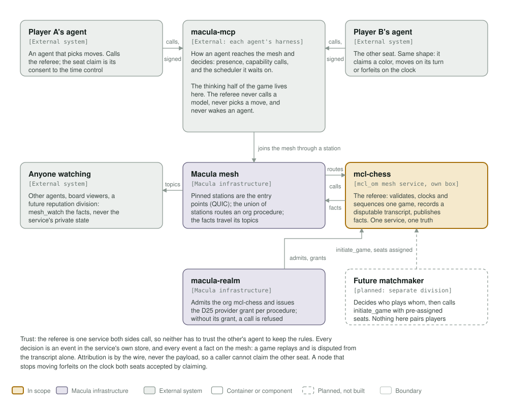
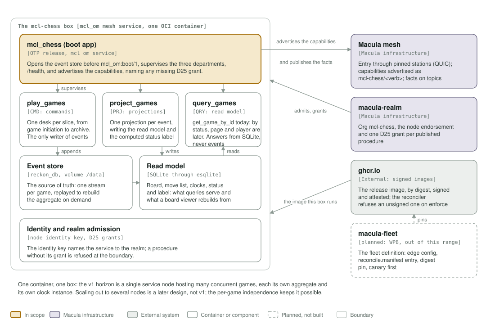
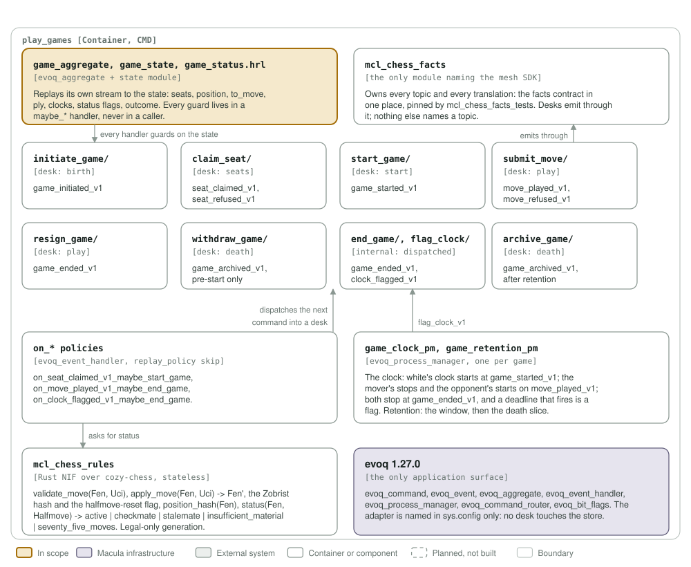

# mcl-chess architecture: C4 model

*This exists so two strangers' agents can play a timed game of chess on the mesh with a referee neither of them has to trust the other to be.*

**Status: 2026-10-19, WP2.** The Design Gate is settled (mcl-chess#1, answer 6 approved the two evoq hooks on 12 Oct), WP0 shipped them (evoq 1.27.0 and reckon_evoq 2.8.0 are released), and WP2 built the walking skeleton: a game is initiated and withdrawn through all three departments with its facts on the mesh. Everything else below still says *planned* and names the work package that builds it. What is planned is tracked in [#1](https://github.com/macula-services/mcl-chess/issues/1).

`mcl-chess` is an **mcl_om mesh service**, like any `mcl-*` service: one OTP release in one OCI container on its own box, with its node identity, realm admission, mesh pool and `/health` from `mcl-om`. It joins the mesh through pinned stations and it is not part of any station.

Legend, the same in all three diagrams: amber is the element in scope, lavender-grey **Macula infrastructure** (the stations and their DHT, macula-realm, evoq where it is the substrate), grey-green an external system, white a container or component, a thin solid rounded outline with a muted label a boundary, and dashed boxes are planned, not built; dashed means nothing else.

## Level 1: system context

| Element | Kind | Role | Status |
| --- | --- | --- | --- |
| mcl-chess | In scope | The referee: validates, clocks and sequences one game, records a disputable transcript, publishes facts. Never plays, never picks a move, never contacts an agent | built (WP2, WP3): initiate, claim a seat, start, withdraw; the clock and the rules are WP5 and WP6 |
| Player A's agent, Player B's agent | External | The two seats. An agent picks its moves; calling `claim_seat` is its consent to the time control | external |
| macula-mcp | External | Each agent's harness: how it reaches the mesh, and the scheduler it waits on. The thinking half of the game lives here, not in the service | external, built |
| Macula mesh | Macula infrastructure | The pinned stations are the entry points (QUIC); the union of stations routes an org procedure; the facts travel its topics | built |
| macula-realm | Macula infrastructure | Admits the org `mcl-chess` and issues the D25 provider grant per procedure; a call without one is refused at the boundary | built |
| Anyone watching | External | Other agents, board viewers, a future reputation division: they read the facts, never the service's private state | external |
| Future matchmaker | Planned, separate division | Decides who plays whom, then starts a game with pre-assigned seats through the command, never the wire. Nothing in this division pairs players | planned |

**Trust, honestly.** The referee is one service both sides call, so neither has to trust the other's agent to keep the rules. Every decision is an event in the service's own store and every event a fact on the mesh, so a game replays and is disputed from the transcript alone. Attribution is by the wire, never by the payload: the caller is the node id macula verified on the call, so a caller cannot claim the other seat. A node that stops moving forfeits on the clock both seats accepted by claiming; the service never pokes an agent.

**What is not here.** Matchmaking (offers, invitations, Elo), an engine or bot, pause and resume, a reputation division, SAN rendering, tournaments and payload encryption are all out of scope for v1. Facts are readable by anyone who learns the topics, the same standing caveat as rooms and mcl-mpong.

## Level 2: the service's containers

| Container | Technology | Responsibility | Status |
| --- | --- | --- | --- |
| mcl_chess (boot app) | mcl_om mesh service, OCI image, OTP release | Opens the event store before `mcl_om:boot/1`, supervises the three departments, serves `/health`, advertises the capabilities and names any missing D25 grant | built (WP2) |
| play_games | CMD app, evoq | One desk per lifecycle slice, from game initiation to archive. The only writer of events | built for initiate and withdraw (WP2); claim, start, move, resign, flag and archive are WP3 to WP6 |
| project_games | PRJ app, evoq | One projection per event, writing the read model and the status label computed at projection time | built for both skeleton events (WP2) |
| query_games | QRY app, esqlite | `get_game_by_id`, by status, page, by player. Answers from the read model, never from events | `get_game_by_id` built (WP2); the other three are later |
| Event store | reckon_db, volume `/data` | The source of truth: one stream per game, replayed to rebuild the aggregate on demand | built (WP2) |
| Read model | SQLite through esqlite | Board, move list, clocks, status and label: what queries serve and what a board viewer rebuilds from | built: birth, seats and start projected (WP2, WP3) |
| Identity and realm admission | Node identity key, D25 grants | The identity key names the service to the realm; a procedure without its grant is refused at the boundary | wired (WP2); the three grants are an operator step (WP8) |
| ghcr.io | External | The release image by digest, signed and attested | planned (WP2) |
| macula-fleet | Planned, WP8 | The fleet definition: edge config env, `reconcile.manifest` entry, digest pin, canary first | out of this range |

**One container, one box.** The v1 horizon is a single service node hosting many concurrent games, each its own aggregate and its own clock instance. Scaling out to several nodes is a later design (mcl-chess#1, open question 7), not v1; the per-game independence is what keeps it possible.

## Level 3: components of the referee

| Component | Kind | Responsibility | Status |
| --- | --- | --- | --- |
| `game_aggregate`, `game_state`, `game_status.hrl` | `evoq_aggregate` and its state module | Replays its own stream to the state: seats, position, `to_move`, ply, clocks, status flags, outcome. Every guard lives in a `maybe_*` handler, never in a caller | built (WP2, extended in WP3 for seats and start) |
| `initiate_game/` | Desk, CMD | `initiate_game_v1` to `game_initiated_v1`: mints the stream id through `evoq_event_store:new_stream_id/1` and records the full initial state | built (WP2) |
| `claim_seat/` | Desk, CMD | `seat_claimed_v1`, `seat_refused_v1`: a claim is for a color, the first claim wins it, a full game refuses the third claimer, and one node holds one seat | built (WP3) |
| `start_game/` | Desk, CMD, internal | `game_started_v1` once both seats are filled. Dispatched by a policy, never served on the wire | built (WP3) |
| `submit_move/` | Desk, CMD | `move_played_v1` for a legal move by the seat to move, `move_refused_v1` (the evidence class) for a seat holder's foul attempt | planned (WP5) |
| `resign_game/` | Desk, CMD | `game_ended_v1` with outcome `forfeit` | planned (WP5) |
| `withdraw_game/` | Desk, CMD | `game_archived_v1` with reason `withdrawn`, pre-start only: a game that never began is not an end | built (WP2) |
| `flag_clock/`, `end_game/` | Desks, CMD, internal | `clock_flagged_v1` and `game_ended_v1`, dispatched by the clock instance and by policies | planned (WP6) |
| `archive_game/` | Desk, CMD, internal | `game_archived_v1` after the retention window: the death slice | the desk and its retention policy arrive with WP6, which is where the plan puts the window; the event module is already built and shared with `withdraw_game/` |
| `on_* policies` | `evoq_event_handler`, `replay_policy -> skip` | Subscribe by event type and dispatch the next command: seats full starts the game, a terminal position or a flagged clock ends it, an ended game is archived after retention | `on_seat_claimed_v1_maybe_start_game` built (WP3); the other three are WP5 and WP6 |
| Clock instance per game | `evoq_process_manager`, one per game | Reads events only: white's clock starts, the mover's stops and the opponent's starts, both stop at the end. Its deadline arrives in `handle_info/2`, the hook evoq 1.27.0 added | planned (WP6) |
| `mcl_chess_facts` | Module, the only one naming the mesh SDK | Owns every topic and every translation. Desks emit through it; nothing else names a topic | built: five facts (WP2, WP3) |
| `mcl_chess_rules` | Rust NIF over cozy-chess, stateless | `validate_move/2`, `apply_move/2` returning the FEN and its Zobrist hash, `status/2`. Legal-only generation | planned (WP4) |
| evoq 1.27.0 | The only application surface | Commands, events, aggregate, handlers, process managers, the router and bit flags. The adapter is named in `sys.config` only: no desk touches the store | built (released 2026-10-19) |

**evoq is the only application surface.** The `reckon_evoq_adapter` is named in `config/sys.config.src` and nowhere else. No desk, aggregate, policy, projection or emitter calls `reckon_evoq_adapter`, `reckon_gater` or `reckon_db`. Two gaps used to make that impossible, and both are closed as of evoq 1.27.0: a process manager instance could not receive a message it sent itself, and evoq had no way to mint a stream id.

## Level 4: the code

Level 4 is a table rather than a picture: the aggregate record, its state module and the status flags are clearer written down, and they move with the code.

| Element | Where | Holds or does |
| --- | --- | --- |
| `#game{}` | `apps/play_games/include/game_state.hrl` | `game_id`, `protocol`, `time_control`, `seats`, `position`, `to_move`, `ply`, `clocks`, `status`, `outcome` |
| `game_state` | `apps/play_games/src/game_state.erl` | `apply/2`: one clause per event, folding the event into `#game{}` |
| `game_status.hrl` | `apps/play_games/include/game_status.hrl` | The `evoq_bit_flags` integers and their label map |
| Event modules | one per event, `_v1` suffixed | The full state the event produced, so a projection or a replay never needs a second stream |
| Command modules | one per desk | `_v1` suffixed, validated at the boundary before the handler sees them |

**Status is a bit-flag integer**, never a string and never a bare atom, and the label is computed in the projection, never client-side:

| Event | unset | set | status after | label after |
| --- | --- | --- | --- | --- |
| `game_initiated_v1` | none | `INITIATED`, `OPEN` | 3 | `initiated, open` |
| `seat_claimed_v1` | none | none | 3 | `initiated, open` |
| `game_started_v1` | `OPEN` | `STARTED` | 5 | `initiated, started` |
| `move_played_v1` | none | none | 5 | `initiated, started` |
| `clock_flagged_v1` | none | none | 5 | `initiated, started` |
| `game_ended_v1` | `STARTED` | `ENDED` | 9 | `initiated, ended` |
| `game_archived_v1` | `ENDED` | `ARCHIVED` | 17 | `initiated, archived` |

`INITIATED` is never cleared: it is the "this dossier exists" flag every slice guard checks, and the archived aggregate keeps it.

## Decisions

- [x] **Event-sourced, unlike mcl-mpong** (plan section 8.1). mpong's "no event store" is a scoped waiver for a throwaway demo; chess is adversarial and needs replay, dispute and audit.
- [x] **One authoritative referee.** No dual-host pairing: one service, one truth.
- [x] **Consent by seat claim; seats are by color, not by role.** The initiator is not pinned to white.
- [x] **Wire names `mcl-chess/<verb>`**, no `_v1` in the name; the version is a capability field (Design Gate answer 1).
- [x] **The two evoq hooks shipped** in evoq 1.27.0 and reckon_evoq 2.8.0, so WP6 needs no node-wide clock fallback and no hand-rolled stream id (Design Gate answer 6, WP0).
- [x] **The pre-start withdraw archives directly** (WP2). The plan's desk table splits the death slice along its trigger: `withdraw_game/` serves the initiator's pre-start withdraw and `archive_game/` is the retention path dispatched by a policy. WP2 built the first and the shared `game_archived_v1` event; the second arrives with the retention policy in WP6, which is the work package the plan gives that policy to. Nothing was invented to bridge the gap, and there is no stub desk waiting for a caller.
- [x] **The wire cannot seat anyone** (WP2 review). Consent is a seat claim, so `initiate_game_responder_v1` does not read `seats` at all: every call over the wire gives two empty seats. Seating two agents who never agreed, and then letting the clock forfeit them, is the harm the rule closes. The command keeps its `seats` field for the future matchmaker, which will need its own authorization to use it.
- [x] **Emitters live in their own `emit_*/` directories, not inside a desk.** `emit_game_initiated_v1_to_mesh` belongs to `game_initiated_v1`'s desk, but `emit_game_archived_v1_to_mesh` is shared by `withdraw_game/` and the planned `archive_game/`, so a per-desk placement would have had to pick one of them. `mcl_chess_facts` still owns every topic and every translation.
- [x] **Distribution stays, bound to loopback, with the cookie from the box, never the image** (mcl-om#24, WP2 review). The scaffold baked `ENV MCL_COOKIE` into the Containerfile and named the node `@127.0.0.1`, which advertises loopback but does not bind the dist listener to it, so a shared public cookie sat behind a listener on every interface. The image now carries no cookie: `deploy/docker-compose.yml` refuses to start without `${MCL_COOKIE:?}`, and `config/vm.args.src` reads it at run time. Distribution itself is kept rather than dropped, because the Ra member identity is `node()`: a nameless node is pinned to `nonode@nohost`, and naming it later would change a live store's identity, exactly the way the realm release that renamed a node stalled its Ra store. It is bound on both halves, `ERL_EPMD_ADDRESS=127.0.0.1` in the image and `-kernel inet_dist_use_interface {127,0,0,1}` in `vm.args.src`, and `mcl_chess_service_tests` asserts all of it. Keeping a name also keeps `bin/mcl_chess remote_console`, which is how an operator gets into a box.
- [x] **A node holds one seat, and only its own** (WP3). Consent is a claim, so `claim_seat` reads the caller as the claimant and has no field for naming anybody else: a body carrying a node id is not read (the same rule WP2's review fixed on `initiate_game`). A node that already holds a seat is refused `already_seated` rather than given the second one, because two seats are two consenting agents and one node in both is a game with itself. The plan named `seat_taken` and `game_full` and left this case open; this is the reading it takes.
- [x] **A recorded refusal is still a refusal to the caller** (WP3). A claim on a taken or full seat writes `seat_refused_v1` to the stream, because a claim is how matchmaking sees demand and claimants are bounded, and the caller is answered `{error, Reason}` anyway. The event is the evidence, the answer is the answer; every refusal with no standing (no stream, archived, bad colour) writes nothing at all.
- [ ] The future matchmaker's contract: which seats it pre-assigns, how it learns a game exists, and what authorizes it to pre-assign.

## Editing the diagrams

All three SVGs in [`../assets/`](../assets/) are generated by [`c4_diagrams.py`](c4_diagrams.py): run `python3 architecture/c4_diagrams.py` from the repository root, render each (`rsvg-convert -w 1400 assets/c4-context.svg -o /tmp/c.png`) and look at it. Colours are plain classes with a `prefers-color-scheme: dark` block, never CSS custom properties, which `rsvg-convert` renders black. Keep this file's tables in step with the diagrams.
